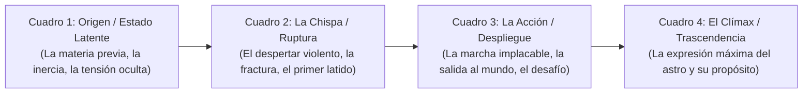

# 🎬 GUÍA MAESTRA DE STORYBOARDS NARRATIVOS (CARTA NATAL TOMÁS)
*Astrology Factory — Secuencias Continuas de Metamorfosis y Sugestión Psicológica*

---

## 🧭 1. EL CONCEPTO: STORYBOARDS DE TRANSFORMACIÓN (MINI-HISTORIAS)

No buscamos 4 imágenes aisladas de stock cósmico. Buscamos un **mini-arco narrativo continuo (4 Keyframes)** protagonizado por el **mismo arquetipo/sujeto** en una progresión dramática. 

### 💡 Cómo aprovechar esto al máximo en Luma Dream Machine / Kling / Runway:
1. **Interpolación directa (Start Frame -> End Frame en Luma):**
   - Clip 1: Cuadro 1 (*Start*) ➡️ Cuadro 2 (*End*). Verás a la figura de piedra cobrar vida, quebrarse y abrir los ojos en un solo plano fluido de 5 segundos.
   - Clip 2: Cuadro 2 (*Start*) ➡️ Cuadro 3 (*End*). Verás al guerrero ponerse de pie y avanzar entre el humo.
   - Clip 3: Cuadro 3 (*Start*) ➡️ Cuadro 4 (*End*). La cámara se acerca al rostro mientras desata su voz de fuego.
2. **Montaje en FFmpeg (Cortes por Afinidad / xfade):**
   - Aunque se animen por separado, al compartir **el mismo personaje, atmósfera y paleta de color**, el encadenamiento genera una sugestión hipnótica completa que acompaña la locución oral sin saltos inconexos.

---

## 🏷️ 2. CONVENCIÓN DE ARCHIVOS PARA LA BÓVEDA

A medida que generes las imágenes, descárgalas y me las pasas (o me dices dónde están). Las nombraremos bajo la convención secuencial:

- **Imágenes estáticas (T2I):**  
  `arte_propio_secuencia_[sujeto]_[astro]_[01_al_04]_[subtema].jpg`  
  *Ejemplo:* `arte_propio_secuencia_tomas_sol_aries_01_gestacion.jpg`  
  👉 Destino: `/home/tomas2/MediaContingencia/Privada/Astrology_Vault/Assets_Auditados/Imagenes/11_Humanos_Emociones/` o `13_Abstracto_Fluidos/` según corresponda.

- **Videos animados (I2V con Luma/Kling):**  
  `anim_[plataforma]_secuencia_[sujeto]_[astro]_[tramo].mp4`  
  *Ejemplo:* `anim_luma_secuencia_tomas_sol_aries_01_a_02.mp4`

---

## 🌌 3. STORYBOARDS CAPÍTULO POR CAPÍTULO: CARTA NATAL DE TOMÁS

---

### ♈ CAPÍTULO 1: LA TRINIDAD DE IDENTIDAD

#### 1.1 SOL EN ARIES (Casa 3): "EL NACIMIENTO DEL GUERRERO PRIMORDIAL Y EL VERBO DE FUEGO"
*Arco narrativo:* El fuego que duerme en la materia fría, despierta por instinto puro, se levanta sin pedir permiso y enciende el pensamiento y la palabra.

- **[Cuadro 1: La Gestación en el Abismo (El Fuego Latente)]**
  - **Narrativa visual:** Una figura humana primordial y andrógina duerme en posición fetal, petrificada como una estatua de basalto negro y carbón, sumergida en cenizas volcánicas frías. Grietas microscópicas de magma naranja comienzan a brillar bajo su piel de piedra. Silencio e inmovilidad absoluta previa a la explosión.
  - **Prompt T2I:** `Cinematic medium shot of a primordial warrior figure sleeping in fetal position encrusted in cold black basalt rock and volcanic ash, delicate glowing orange magma fissures branching beneath the dark stone skin, eerie quiet darkness, faint embers drifting in zero gravity, cinematic dark fantasy, photorealistic 8k, volumetric soft rim light, 35mm --ar 9:16`
  - **Motion I2V (Luma / Kling):** *"Camera slowly orbiting the sleeping stone figure, magma cracks pulsing softly with increasing inner heat, tiny embers rising slowly."*
  - **Archivo:** `arte_propio_secuencia_tomas_sol_aries_01_gestacion.jpg`

- **[Cuadro 2: La Fractura y el Primer Latido (El Despertar del Impulso)]**
  - **Narrativa visual:** Mismo sujeto. La cáscara de piedra explota desde adentro. La figura abre los ojos bruscamente, revelando pupilas de oro ardiente y fuego puro. El pecho se parte en una fractura incandescente liberando una onda de choque de plasma solar. El primer instante de vida consciente.
  - **Prompt T2I:** `Dynamic medium close-up of the same stone warrior violently breaking out of the basalt shell, opening glowing golden fiery eyes, intense raw expression of awakening life, molten gold and solar plasma bursting from cracked chest, stone fragments floating in violent explosion, intense volumetric lighting, cinematic masterpiece --ar 9:16`
  - **Motion I2V (Luma / Kling):** *"Explosive burst of light from the chest, stone fragments blowing outward, head snapping forward with glowing eyes opening wide."*
  - **Archivo:** `arte_propio_secuencia_tomas_sol_aries_02_despertar.jpg`

- **[Cuadro 3: La Puesta de Pie (La Marcha Sin Permiso)]**
  - **Narrativa visual:** Mismo sujeto, ya completamente encarnado. Un guerrero de rasgos afilados y piel morena con cicatrices de magma enfriado, de pie en la cima de un risco volcánico. Viste una armadura ligera de obsidiana forjada por el propio calor. Da un paso firme y decidido hacia la oscuridad, empuñando una antorcha de luz solar. No mira atrás.
  - **Prompt T2I:** `Full body cinematic wide shot of the same warrior standing tall on a jagged obsidian mountain ridge, wearing rugged minimalist dark obsidian armor with glowing amber runes, holding a blazing torch of pure solar plasma, taking an aggressive confident step forward into the dark void, smoke and embers swirling in high wind, epic scale --ar 9:16`
  - **Motion I2V (Luma / Kling):** *"Slow powerful camera tracking low angle as the warrior takes a heavy determined step forward, torch flame whipping in wind, embers trailing."*
  - **Archivo:** `arte_propio_secuencia_tomas_sol_aries_03_marcha.jpg`

- **[Cuadro 4: El Verbo que Enciende el Mundo (Casa 3: La Palabra Solar)]**
  - **Narrativa visual:** Primer plano cinematográfico (close-up) de su rostro. Expresión feroz de lucidez y convicción absoluta. Abre la boca para hablar o lanzar un grito de guerra: de su voz y sus manos emanan ondas de choque geométricas de luz dorada que barren la oscuridad y crean constelaciones en la noche. El fuego se ha hecho mente y palabra.
  - **Prompt T2I:** `Intense cinematic close-up of the same warrior shouting with fierce clarity and conviction, golden cymatic soundwaves and radiant solar light erupting from his parted lips and outstretched hands, illuminating his weathered determined face in stark chiaroscuro, dark atmospheric void background, 35mm film grain, 8k --ar 9:16`
  - **Motion I2V (Kling AI):** *"Piercing gaze into camera, lips parting as radiant golden light rays beam forward, atmospheric smoke parting around the face, steady slow push in."*
  - **Archivo:** `arte_propio_secuencia_tomas_sol_aries_04_verbo.jpg`

---

#### 1.2 LUNA EN SAGITARIO (Casa 10): "EL NÓMADE QUE PERSIGUE EL HORIZONTE CELESTE"
*Arco narrativo:* El alma que se asfixia bajo techos bajos y mandatos estrechos, rompe las cadenas de la ciudadela, corre hacia las llanuras abiertas y corona la montaña cósmica disparando la flecha de su verdad hacia el infinito.

- **[Cuadro 1: La Asfixia en la Caverna (El Límite que Oprime)]**
  - **Narrativa visual:** Un viajero nómade de mirada inquieta atrapado dentro de una cripta de piedra angosta y pesada. Las sombras lo aprisionan. Mira con desesperación hacia una grieta alta en el techo por donde se filtra luz estelar morada. Sus manos tocan los muros buscando aire; no puede respirar donde no hay horizonte.
  - **Prompt T2I:** `Cinematic shot of a restless traveler trapped inside a narrow, low-ceilinged dark stone crypt, shadows closing in, the figure staring intensely upward through a narrow crack in the ceiling where distant purple starlight leaks through, hands touching the cold walls yearning for air, claustrophobic atmosphere, moody chiaroscuro --ar 9:16`
  - **Archivo:** `arte_propio_secuencia_tomas_luna_sagitario_01_encierro.jpg`

- **[Cuadro 2: La Fuga en Carrera (El Galope Libre)]**
  - **Narrativa visual:** Mismo viajero. Ha reventado las rejas y corre a velocidad sobrehumana por una llanura infinita bajo un cielo nocturno colosal lleno de galaxias. Su capa oscura ondea al viento salvaje. Una risa de alivio y euforia salvaje en su rostro; el movimiento le devuelve la vida.
  - **Prompt T2I:** `Dynamic medium-wide tracking shot of the same traveler sprinting at breathtaking speed out of a shattered stone gate into a vast open prairie beneath an immense celestial indigo sky, long dark cloak billowing behind, wild laughter and raw exhilaration on their face, motion blur, starlight reflections --ar 9:16`
  - **Archivo:** `arte_propio_secuencia_tomas_luna_sagitario_02_escape.jpg`

- **[Cuadro 3: El Ascenso a la Cima (Casa 10: La Cumbre Expuesta)]**
  - **Narrativa visual:** Mismo viajero. Llega a la cima solitaria de un pico escarpado que atraviesa el mar de nubes. Está de pie en la cornisa más alta del mundo, con los brazos abiertos recibiendo el viento cósmico y las auroras boreales. Su emoción es visible para todo el cielo.
  - **Prompt T2I:** `Heroic wide shot of the same traveler standing at the precipice of an impossible vertical mountain peak that pierces through the sea of clouds into the open galaxy, open arms welcoming the freezing cosmic wind, glowing purple and teal auroras cascading above, supreme freedom, 8k --ar 9:16`
  - **Archivo:** `arte_propio_secuencia_tomas_luna_sagitario_03_cumbre.jpg`

- **[Cuadro 4: El Disparo a las Estrellas (La Flecha de la Verdad)]**
  - **Narrativa visual:** Primer plano del viajero tensando la cuerda de un arco de plata y madera oscura. La flecha es un rayo de luz blanca que apunta directamente al corazón de una nebulosa lejana. Mirada certera, sin titubeos: disparar a lo que nadie más se atreve a soñar.
  - **Prompt T2I:** `Close-up shot of the same traveler pulling back the string of a luminous silver recurve bow, aiming a blazing arrow of pure white starlight directly at a distant spiral galaxy, intense focused confident eyes, silver hair whipping across face, transcendent spiritual truth, cinematic masterpiece --ar 9:16`
  - **Archivo:** `arte_propio_secuencia_tomas_luna_sagitario_04_flecha.jpg`

---

#### 1.3 ASCENDENTE EN ACUARIO (Casa 1): "EL OBSERVADOR CUÁNTICO Y EL PRISMA DE LUZ"
*Arco narrativo:* Entrar al mundo no como un soldado ni como un siervo, sino como una mente lúcida que decodifica las leyes invisibles, se desapega del drama colectivo y proyecta el mapa del futuro.

- **[Cuadro 1: La Lluvia de Datos en la Noche (El Ruido del Mundo)]**
  - **Narrativa visual:** Una metrópolis oscura y húmeda donde la masa humana camina con la cabeza gacha bajo una lluvia ácida y cables colgantes. En medio de la multitud gris, una figura solitaria permanece inmóvil con las manos en los bolsillos, observando el engranaje con total frialdad y desapego.
  - **Prompt T2I:** `Cinematic atmospheric shot of an ancient dark metropolis drowning in deep blue shadows and dense fog, cold rain falling through tangled glowing neon threads and static interference, feeling of heavy obsolete mechanical world, a solitary figure standing motionless observing the crowd --ar 9:16`
  - **Archivo:** `arte_propio_secuencia_tomas_asc_acuario_01_matrix.jpg`

- **[Cuadro 2: El Ojo Lúcido (La Visión Geométrica)]**
  - **Narrativa visual:** Primer plano extremo del rostro del observador. En sus ojos grises se reflejan circuitos de luz cian, mallas de tetraedros y fórmulas matemáticas cósmicas. No hay juicio ni desprecio; hay una lucidez quirúrgica que ve la arquitectura oculta detrás de la ilusión.
  - **Prompt T2I:** `Intense close-up of a sharp, elegant, enigmatic human face emerging from darkness, glowing cyan geometric reticles and sacred algorithmic grids reflecting precisely across pale gray irises, serene unbothered expression, cool blue rim lighting, hyper-realistic skin --ar 9:16`
  - **Archivo:** `arte_propio_secuencia_tomas_asc_acuario_02_observador.jpg`

- **[Cuadro 3: El Puente de Luz en el Abismo (La Salida Vertical)]**
  - **Narrativa visual:** Mismo sujeto caminando con calma sobre un puente geométrico de luz flotante suspendido a kilómetros de altura sobre el abismo. El mundo viejo queda abajo, disuelto en niebla. Sus pasos dejan ondas de frecuencia electromagnética.
  - **Prompt T2I:** `Wide cinematic shot of the same figure in sleek minimalist dark trenchcoat walking casually across a bridge made of pure suspended holographic geometry floating high above the clouds, leaving glowing cyan footprints, infinite starry abyss below --ar 9:16`
  - **Archivo:** `arte_propio_secuencia_tomas_asc_acuario_03_puente.jpg`

- **[Cuadro 4: El Prisma Alquímico (La Refracción del Futuro)]**
  - **Narrativa visual:** Plano medio. El observador sostiene en su mano abierta un prisma cristalino levitando. Un haz de luz blanca entra en él y se descompone en un mapa holográfico de constelaciones doradas y turquesas. Una leve sonrisa de quien sabe que el futuro ya está escrito.
  - **Prompt T2I:** `Medium shot of the same figure extending an open palm where a floating hyper-complex crystal polyhedron refracts chaos into a harmonious sphere of golden and turquoise constellations, mysterious knowing smile, feeling of a visionary who sees 100 years into the future --ar 9:16`
  - **Archivo:** `arte_propio_secuencia_tomas_asc_acuario_04_prisma.jpg`

---

### 💬 CAPÍTULO 2: MENTE, VÍNCULOS Y ACCIÓN (Mercurio, Venus, Marte)

#### 2.1 MERCURIO EN ARIES (Casa 3): "LA CHISPA DEL PENSAMIENTO RELÁMPAGO Y EL VERBO DIRECTO"
*Arco narrativo en 4 tomas:* La mente rápida que no da vueltas. De la sobrecarga eléctrica de una idea que quema, al estallido eureka, el grabado de letras incandescentes y el orador que corta el humo con la verdad.

- **[Cuadro 1: La Tensión y la Sobrecarga Mental]**
  - **Narrativa:** Un erudito o pensador de rasgos afilados e intensos sentado en una biblioteca de metal oscuro, agarrándose la cabeza en máxima concentración. Micro-relámpagos y chispas eléctricas saltan de sus sienes hacia pergaminos de cobre y libros antiguos.
  - **Prompt T2I:** `Cinematic medium shot of an intense sharp-featured thinker sitting at a dark iron study desk clutching his temples in raw mental concentration, tiny electric sparks and gold plasma arcs leaping from his head to copper scrolls and open alchemical books, dark moody chiaroscuro lighting, 35mm film grain, 8k --ar 9:16`
  - **Archivo:** `arte_propio_secuencia_tomas_mercurio_aries_01_tension.jpg`

- **[Cuadro 2: El Rayo Eureka (La Pluma de Fuego)]**
  - **Narrativa:** Mismo sujeto. Alza la cabeza con una mirada fulgurante de iluminación total. Un relámpago de plasma dorado golpea su mano derecha, transmutando una pluma de hierro en un estilete de fuego blanco puro.
  - **Prompt T2I:** `Dynamic close-up of the same thinker snapping his head upward with blazing triumphant eyes, a sudden bolt of golden lightning striking his outstretched hand, igniting a heavy iron quill pen into pure white-hot plasma fire, sparks showering across his face, intense volumetric lighting --ar 9:16`
  - **Archivo:** `arte_propio_secuencia_tomas_mercurio_aries_02_eureka.jpg`

- **[Cuadro 3: El Trazo Incandescente en el Pergamino]**
  - **Narrativa:** Mismo sujeto de pie, escribiendo con velocidad relámpago sobre un gran papiro negro. La punta de fuego graba caracteres y símbolos geométricos que arden y liberan chispas en el aire, desintegrando las falsas ideas en cenizas.
  - **Prompt T2I:** `Medium shot of the same thinker aggressively engraving burning fiery symbols and geometric runes onto a massive dark obsidian scroll, the blazing quill hissing and carving glowing red embers into the surface, smoke rising from the manuscript, dynamic energetic pose --ar 9:16`
  - **Archivo:** `arte_propio_secuencia_tomas_mercurio_aries_03_escritura.jpg`

- **[Cuadro 4: La Palabra que Corta la Niebla (Casa 3: El Orador Directo)]**
  - **Narrativa:** Primer plano del orador en claroscuro. Señala con el estilete encendido hacia adelante mientras habla con convicción sin filtro; de sus labios emanan ondas sonoras doradas que parten la densa niebla circundante.
  - **Prompt T2I:** `Intense cinematic close-up profile of the same thinker speaking with fierce conviction and authority, golden soundwaves and delicate acoustic fire rippling from his lips to part the heavy dark mist around him, sharp jaw, piercing direct gaze, 8k masterpiece --ar 9:16`
  - **Archivo:** `arte_propio_secuencia_tomas_mercurio_aries_04_orador.jpg`

> 🎥 **PROMPT UNIFICADO PARA LUMA (Mercurio en Aries):**
> `Continuous intellectual metamorphosis sequence: a sharp-faced scholar clutches his temples in mental tension as electrical sparks arc across his iron desk; a sudden bolt of golden lightning strikes his hand, igniting his pen into pure white plasma as his eyes flash open in eureka triumph; he furiously engraves blazing fiery runes onto a black obsidian scroll with smoke and embers flying; camera glides to a dramatic close-up as he speaks with fierce clarity, acoustic golden soundwaves parting the dark fog in front of his lips. Kinetic sparking physics, rapid ink carving motion, expanding sonic shockwaves, seamless transformation, zero static camera zoom.`

#### 2.2 VENUS EN PISCIS (Casa 1): "LA DISOLUCIÓN OCEÁNICA DEL CORAZÓN Y LA MÍSTICA DEL CUERPO"
*Arco narrativo en 4 tomas:* La entrega absoluta y la disolución de los límites del ego en el mar del inconsciente. De la orilla solitaria a la sumersión, la metamorfosis bioluminiscente y el florecimiento de la perla mística en el pecho.

- **[Cuadro 1: La Llegada a la Orilla Abisal (El Llamado del Silencio)]**
  - **Narrativa:** Una figura serena y melancólica de belleza etérea vestida con túnica oscura camina descalza hacia la orilla de un mar abisal bajo la luz de una inmensa luna llena perlada. Sus pies tocan el agua tibia iluminada por fitoplancton bioluminiscente.
  - **Prompt T2I:** `Cinematic wide shot of an ethereal and serene melancholic figure with long dark hair walking barefoot into the calm edge of a bioluminescent midnight ocean, immense glowing pearlescent full moon hanging low in the sky, translucent dark silk robes trailing in turquoise glowing sea foam, dreamy atmospheric mist, 35mm film grain, 8k --ar 9:16`
  - **Archivo:** `arte_propio_secuencia_tomas_venus_piscis_01_orilla.png`

- **[Cuadro 2: La Inmersión en las Aguas Místicas (El Abandono del Ego)]**
  - **Narrativa:** Mismo sujeto hundiéndose suavemente hacia atrás en las aguas transparentes y profundas de color turquesa y zafiro, con los brazos extendidos y el rostro en paz absoluta, mientras su ropa flota como velos etéreos.
  - **Prompt T2I:** `Medium shot of the same ethereal figure gently falling backward into crystal clear deep turquoise water, submerged with arms outstretched in complete surrender and peaceful release, dark silk robes floating like weightless jellyfish ribbons around the body, soft moonlight filtering through the surface ripples --ar 9:16`
  - **Archivo:** `arte_propio_secuencia_tomas_venus_piscis_02_inmersion.png`

- **[Cuadro 3: La Metamorfosis Bioluminiscente (El Cuerpo Hecho Océano)]**
  - **Narrativa:** Mismo sujeto sumergido flotando en gravedad cero bajo el agua. Sus ojos están abiertos mirando hacia el resplandor de la luna a través de la superficie. De su piel y de su pecho emergen delicadas cintas de luz turquesa y magenta, fusionándose con medusas bioluminiscentes flotantes.
  - **Prompt T2I:** `Full underwater medium shot of the same figure floating in zero-gravity suspended in deep ocean abyss, open compassionate eyes gazing upward at shimmering water surface, delicate bioluminescent magenta and cyan light tendrils radiating softly from their skin and heart, surrounded by glowing translucent sea creatures, cinematic fantasy realism --ar 9:16`
  - **Archivo:** `arte_propio_secuencia_tomas_venus_piscis_03_metamorfosis.png`

- **[Cuadro 4: El Corazón de Perla Cósmica (Casa 1: La Belleza Encarnada)]**
  - **Narrativa:** Primer plano cinematográfico bajo el agua. La figura sonríe con devoción mística mientras sostiene entre sus dos manos un orbe o perla viva de luz estelar pura que ilumina su rostro de nácar. Una lágrima de agua marina brilla en su mejilla.
  - **Prompt T2I:** `Intense cinematic underwater close-up of the same figure's serene face illuminated by a living glowing pearl of celestial white and coral light cupped between their delicate hands, wet skin reflecting iridescent caustics, subtle tears of pure light drifting away in the water, transcendent spiritual unconditional love, 8k masterpiece --ar 9:16`
  - **Archivo:** `arte_propio_secuencia_tomas_venus_piscis_04_perla.png`

> 🎥 **PROMPT UNIFICADO PARA LUMA (Venus en Piscis):**
> `Continuous oceanic metamorphosis sequence: an ethereal dark-robed figure walks softly into a bioluminescent sea under an immense pearlescent moon; the figure gently falls backward, submerging gracefully into deep crystal-clear turquoise waters in complete peaceful surrender; floating in weightless zero gravity, radiant ribbons of magenta and cyan light bloom from their skin and chest alongside glowing jellyfish; camera drifts in to an intimate close-up as the figure cups a radiant living pearl of celestial light between both hands, illuminating their serene smiling face. Fluid underwater physics, floating translucent fabric, bioluminescent caustics dancing, seamless metamorphosis, zero static camera zoom.`

#### 2.3 MARTE EN LIBRA (Casa 8): "EL DUELO DEL GUERRERO DIPLOMÁTICO Y EL CORTE QUIRÚRGICO"
*Arco narrativo en 4 tomas:* La guerra psicológica y la acción estratégica en el territorio de las sombras compartidas (Casa 8). De la tensión en el tablero aristocrático a la precisión del acero, el corte de la atadura invisible y la restauración del equilibrio sagrado.

- **[Cuadro 1: El Banquete del Tablero Oculto (La Estrategia en la Penumbra)]**
  - **Narrativa:** Un estratega aristocrático de mirada gélida y penetrante, vestido con terciopelo negro y bordados en plata oscura, sentado a una mesa de banquete de obsidiana en un salón gótico iluminado por candelabros de fuego azul. Sobre la mesa reposa una balanza de bronce antiguo inclinada y copas de cristal tallado. Frente a él, una silla vacía ocupada por una sombra amenazante.
  - **Prompt T2I:** `Cinematic wide shot of a sharp-eyed aristocratic strategist in midnight black velvet and dark silver embroidery seated at an obsidian banquet table in a dimly lit gothic hall with tall arched windows, candles with cold blue flames, an ancient bronze balance scale tilted on the table next to cut crystal goblets of deep crimson wine, tense psychological duel across an empty seat, atmospheric dark fantasy, 35mm film grain, 8k --ar 9:16`
  - **Archivo:** `arte_propio_secuencia_tomas_marte_libra_01_banquete.png`

- **[Cuadro 2: La Tensión del Hilo Rojo y el Desenvaine (La Provocación)]**
  - **Narrativa:** Plano medio del mismo estratega. Con elegancia impecable y sin mover un músculo del rostro, desenvaina desde su manga de seda una fina daga de acero damasquino plateado que refleja la luz fría. En el aire entre él y la sombra, una red de hilos carmesí tensos como cuerdas de violín vibra a punto de romperse.
  - **Prompt T2I:** `Medium shot of the same aristocratic strategist calmly drawing a slender damascus steel stiletto dagger from his tailored silk sleeve, reflection of cold moonlight on the polished silver blade, glowing tense red puppet strings suspended in the dark air between him and the shadowy presence, cold calculated poise, hyper-detailed --ar 9:16`
  - **Archivo:** `arte_propio_secuencia_tomas_marte_libra_02_desenvaine.png`

- **[Cuadro 3: El Corte Quirúrgico en la Penumbra (La Acción Impecable)]**
  - **Narrativa:** Plano cinemático de movimiento suspendido. El estratega ejecuta una estocada relámpago con la gracia letal de un maestro esgrimista: el filo de plata corta limpiamente la telaraña de hilos rojos, provocando una lluvia de chispas escarlata y fragmentando la sombra enemiga en jirones de niebla negra y humo plateado.
  - **Prompt T2I:** `Dynamic cinematic freeze-frame shot of the strategist executing a lightning-fast precise thrust with his slender silver blade, cleanly severing glowing red strings with a burst of incandescent scarlet sparks, the shadowy figure shattering into swirling black smoke and silver embers, master swordsman grace, dramatic directional lighting --ar 9:16`
  - **Archivo:** `arte_propio_secuencia_tomas_marte_libra_03_estocada.png`

- **[Cuadro 4: La Balanza en Equilibrio Absoluto (El Orden Restaurado)]**
  - **Narrativa:** Primer plano medio cinematográfico. El estratega envaina la daga de plata en su funda con calma imperturbable. En el centro de la mesa, la balanza de bronce se estabiliza en un perfecto equilibrio horizontal bajo un haz de luz dorada cenital que disipa la oscuridad. Una leve sonrisa de triunfo intelectual y dominio total en su rostro.
  - **Prompt T2I:** `Cinematic close-up of the serene aristocratic strategist sheathing the slender silver dagger into an ornate scabbard, subtle knowing smirk of absolute mastery, behind his shoulder the bronze balance scale settles into flawless horizontal equilibrium under a beam of warm golden celestial light cutting through the gothic gloom, 8k masterpiece --ar 9:16`
  - **Archivo:** `arte_propio_secuencia_tomas_marte_libra_04_balanza.png`

> 🎥 **PROMPT UNIFICADO PARA LUMA (Marte en Libra):**
> `Continuous strategic duel sequence: an elegant black-velvet dressed strategist sits calmly at an obsidian table facing a looming dark shadow across an ancient tilted balance scale; with lethal grace, he smoothly draws a slender silver stiletto dagger from his silk sleeve as tense glowing red threads vibrate in the air; in a sudden burst of razor precision he lunges forward, slicing the threads and shattering the shadow into exploding crimson sparks and black smoke; camera pans as he calmly sheathes the blade, the bronze scale settling into flawless horizontal balance under a beam of warm golden light. Aristocratic swordsmanship physics, scattering smoke embers, elegant cloth motion, seamless metamorphosis, zero static camera zoom.`

---

### ⚔️ CAPÍTULO 7: LA GRAN OPOSICIÓN (Eje 3-9: Sol/Mercurio vs Saturno/Plutón)
*Arco narrativo de 2 personajes:* La colisión frontal entre el Guerrero Solar (la chispa mental inmediata) y el Monolito de Saturno/Plutón (la ley del tiempo y el poder kármico).

- **Cuadro 1 (El Reto):** El joven guerrero de fuego (Sol en Aries) plantado con los puños encendidos ante las puertas ciclópeas de una fortaleza de granito negro custodiada por una figura titánica con manto de hierro y una guadaña de basalto (Saturno/Plutón).
  - `Cinematic wide shot of the fiery warrior standing defiant before colossal iron gates guarded by a massive looming titan in basalt armor holding an ancient scythe, tension before war --ar 9:16`
- **Cuadro 2 (El Choque Implacable):** El guerrero lanza su rayo de fuego contra el escudo del titán: el impacto crea una onda expansiva cósmica de oro y sombras moradas que agrieta la tierra. La chispa no retrocede; la ley no se rompe. Tensión viva.
  - `Epic collision shot: golden solar fire slamming violently against an impenetrable wall of dark platinum and obsidian, shockwaves shattering the stone ground, hyper-detailed particles --ar 9:16`
